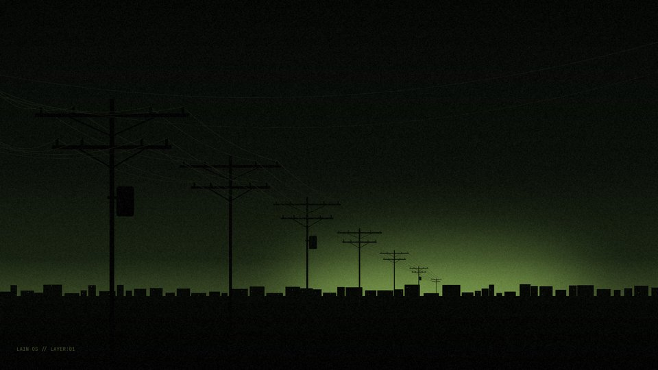
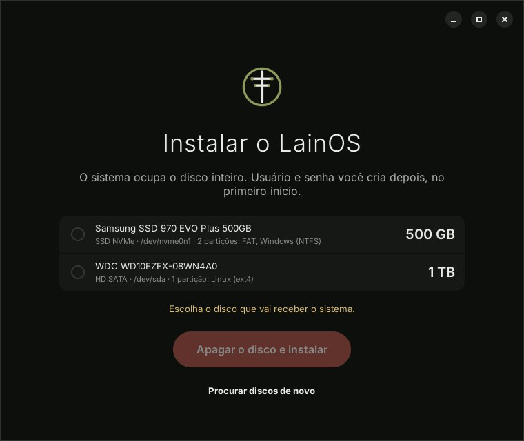
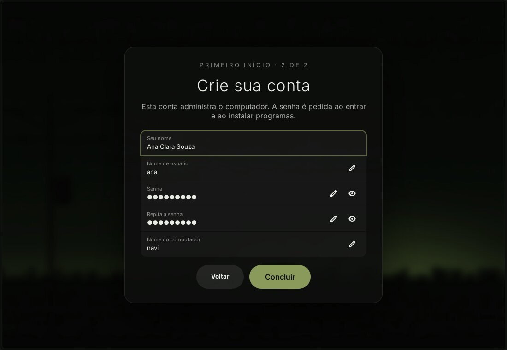
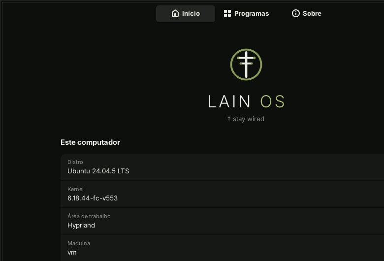
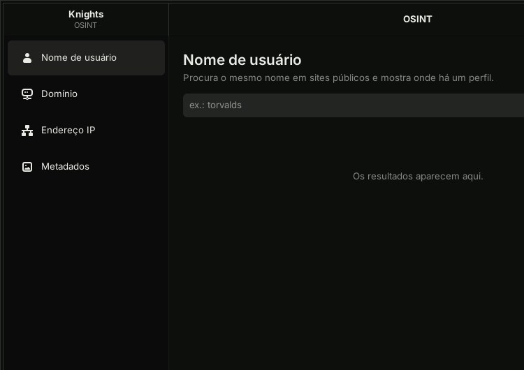

# ‡ LainOS

**stay wired.** Uma distribuição Linux escura, leve e bonita, feita para
programar, estudar segurança e para quem gosta da atmosfera de
*Serial Experiments Lain*. Base Arch Linux, área de trabalho Hyprland já
configurada, com animações suaves e uso confortável tanto pelo teclado quanto
pelo mouse.



Toda a arte (logo, papéis de parede, telas de boot, arte do terminal) é
original e gerada por `branding/generate.py`. Nenhuma imagem do anime vem na
ISO; se quiser usar as suas, veja [Personalizar](#personalizar).

---

## Como conseguir a ISO

A ISO é montada a partir deste projeto. Escolha um caminho:

### A) Pelo GitHub (recomendado, não precisa instalar nada)

1. Crie um repositório vazio no GitHub e envie esta pasta inteira para ele
   (pelo GitHub Desktop, ou `git push`). Use a branch `main`.
2. O envio dispara sozinho o fluxo **Montar a ISO** (aba *Actions*). Ele:
   - roda os testes rápidos;
   - monta a ISO num contêiner Arch Linux (30 a 60 minutos);
   - liga a ISO numa máquina virtual, **instala num disco virtual**, liga o
     disco instalado e cria uma conta pelo primeiro início, tirando fotos de
     cada etapa;
   - publica a ISO em **Releases**, com o SHA-256.
3. Baixe a ISO em *Releases*. Se ela passar de 2 GB, vem em partes
   (`.part0`, `.part1`...) e as notas do lançamento explicam como juntar.

Para montar de novo quando quiser: *Actions* > *Montar a ISO* > *Run workflow*.
Em repositório público os minutos do Actions são grátis; em privado, cada
build consome cerca de 1h30 da cota mensal.

### B) No Windows, com Docker Desktop

Com o Docker Desktop aberto e uns 20 GB livres, no PowerShell, dentro desta pasta:

```powershell
Set-ExecutionPolicy -Scope Process Bypass   # só se o PowerShell recusar o script
.\build.ps1          # ISO em .\out (20 a 60 minutos)
.\build.ps1 -Fast    # compressão leve: mais rápido, ISO maior (bom para testar)
```

### C) No Linux

Num Arch Linux, ou em qualquer distro com Docker (o script entra num contêiner
Arch sozinho):

```bash
sudo ./build.sh             # ISO em ./out
sudo ./build.sh --fast      # compressão leve
./build.sh --list-packages  # só confere os nomes dos pacotes
```

O `build.sh` confere cada pacote de `packages/iso.txt` contra os repositórios
antes de começar: um nome errado para o build em segundos, com uma mensagem
clara, em vez de falhar no meio.

---

## Instalar

> **A instalação apaga o disco escolhido inteiro**: Windows, outros Linux,
> arquivos, tudo. Faça backup antes.

1. **Grave a ISO num pendrive**: [Rufus](https://rufus.ie) (quando perguntar,
   escolha *modo DD*), [balenaEtcher](https://etcher.balena.io) ou
   [Ventoy](https://www.ventoy.net).
2. **Inicie o computador pelo pendrive** (F12, F11, F8 ou Esc no boot, depende
   da placa-mãe). Desligue o **Secure Boot** na BIOS/UEFI.
3. A sessão ao vivo abre sozinha na área de trabalho. Se pedir, o usuário é
   `wired` e a senha é `live`.
4. Abra **Instalar o LainOS** (no app de boas-vindas ou no menu), escolha o
   disco e clique em **Apagar o disco e instalar**. São uns 5 a 15 minutos.
5. Reinicie e tire o pendrive.



Com mais de um disco no computador, nenhum vem marcado: você escolhe. O
pendrive de instalação nunca aparece na lista. O disco recebe uma tabela GPT
que inicia tanto em computadores UEFI quanto nos antigos (BIOS).

### Primeiro início

Na primeira vez que o sistema instalado liga, aparece um assistente de duas
telas: **teclado e fuso horário**, depois **seu nome, usuário, senha e nome do
computador**. Ao concluir, você já entra na área de trabalho.



Se a tela gráfica não aparecer (placa de vídeo sem driver, por exemplo),
aperte **Ctrl+Alt+F2**: o mesmo passo existe em modo texto.

A conta criada é administradora (usa `sudo`). A conta root vem travada.

---

## O que vem pronto

| | |
|---|---|
| **Área de trabalho** | Hyprland com animações, blur, dock, barra (Waybar), notificações, lançador e tela de bloqueio, tudo no tema preto, branco e verde-musgo |
| **Terminal** | kitty + zsh limpo, com a arte do LainOS e as informações do PC (distro, versão, kernel, CPU, placa de vídeo, memória) ao abrir |
| **Navegador** | Firefox endurecido (sem telemetria, HTTPS sempre, proteção contra rastreio estrita, uBlock Origin, DuckDuckGo) com página inicial própria |
| **Navi Ghost** | um Firefox à parte que só navega pelo Tor (`SUPER SHIFT B`) |
| **Tor e proxy** | Tor Browser (pelo launcher oficial), proxy Tor do sistema com um atalho (`SUPER SHIFT T`), proxychains e torsocks |
| **VPN** | WireGuard e OpenVPN integrados ao NetworkManager; `lain-vpn import arquivo.conf` |
| **Firewall** | ufw ligado, bloqueando conexões de entrada |
| **Hermes Agent** | o agente da Nous Research é baixado no primeiro login e configurado quando você abre pela primeira vez (`SUPER H` ou `hermes`) |
| **Knights OSINT** | app próprio para OSINT: nomes de usuário em sites públicos, domínio (DNS e WHOIS), IP e metadados de arquivos |
| **Boas-vindas** | informações do sistema, instalador e os pacotes extras com um clique |




### Pacotes extras (pelo app de boas-vindas ou `lain-bundle`)

A ISO é enxuta de propósito. O resto entra depois, com um clique:

- **Jogos**: Steam com Proton, Lutris, GameMode, MangoHud, Gamescope, Wine
- **Driver NVIDIA** proprietário
- **Desenvolvimento**: VS Code, Docker, Node.js, Python, Go, Rust, GitHub CLI e lazygit
- **Servidor próprio**: Docker, Caddy (web com HTTPS automático), painel Cockpit, SSH endurecido com fail2ban e túnel Cloudflare
- **Arsenal**: rede, web, senhas, wireless, exploração e engenharia reversa, ou o
  BlackArch completo, para estudo, CTF e testes autorizados
- **Anonimato e privacidade**: OnionShare, KeePassXC, limpeza de metadados (mat2)

```bash
lain-bundle list              # o que existe e o que já está instalado
lain-bundle install jogos     # instala um conjunto
```

### Atalhos principais

`SUPER` é a tecla do Windows. A lista completa aparece com **SUPER F1**.

| Atalho | Faz |
|---|---|
| `SUPER Enter` | terminal |
| `SUPER Espaço` | buscar e abrir um app |
| `SUPER A` | grade de todos os apps |
| `SUPER E` | arquivos |
| `SUPER B` | Firefox |
| `SUPER Q` | fechar a janela |
| `SUPER F` | tela cheia |
| `SUPER V` | soltar ou encaixar a janela |
| `SUPER` + arrastar | mover a janela com o mouse |
| `SUPER Esc` | desligar, reiniciar, sair |
| `SUPER L` | bloquear |
| `SUPER W` | trocar o papel de parede |
| `SUPER SHIFT P` | modo leve (desliga animações e blur) |
| `Print` | captura de uma área |

Gestos no touchpad: três dedos para os lados trocam de área de trabalho.

### Comandos da distro

| Comando | Para quê |
|---|---|
| `lain-update` | atualiza o sistema inteiro |
| `lain-bundle` | pacotes extras |
| `lain-proxy on\|off\|status` | proxy Tor do sistema (para um comando só: `px comando`) |
| `lain-vpn` | VPN |
| `lain-serve [pasta] [porta]` | sobe um servidor web na hora |
| `lain-style` | troca logo, arte do terminal e papel de parede |
| `lain-performance` | modo leve |
| `man lainos` | guia rápido |

---

## Personalizar

A arte do terminal, os papéis de parede e as telas de bloqueio e de login podem
ser trocados pelos seus, sem mexer em código:

```bash
lain-style terminal-art minha-imagem.png   # imagem no lugar da arte do terminal
lain-style wallpaper minha-imagem.jpg      # papel de parede
lain-style lock minha-imagem.jpg           # tela de bloqueio
lain-style login minha-imagem.jpg          # tela de login
lain-style reset                           # volta tudo ao padrão
```

A arte em texto do terminal fica em `~/.config/fastfetch/logo.txt`.

Para mudar a arte que vem na ISO, edite `branding/generate.py` e rode
`python3 branding/generate.py` (precisa do Pillow).

---

## Requisitos

- PC de 64 bits (x86_64), UEFI ou BIOS, **Secure Boot desligado**
- 4 GB de RAM (8 GB recomendado)
- disco de pelo menos 12 GB (40 GB ou mais se for instalar jogos)
- placa de vídeo com suporte a OpenGL 3/Vulkan: Intel, AMD ou NVIDIA (para a
  NVIDIA, instale o pacote *Driver NVIDIA* depois)
- em máquina virtual, ligue a **aceleração 3D** (VirtualBox: VMSVGA + 3D;
  VMware: acelerar gráficos 3D; QEMU: `virtio-vga-gl`); sem ela o Hyprland
  pode não abrir

---

## O que foi testado

Testado automaticamente (rode `tests/run.sh`):

- todos os scripts passam no `shellcheck`; todo o Python compila;
- 60 testes de unidade: escolha de discos (o pendrive de instalação nunca
  aparece), validação de usuário, senha e nome do computador, a conversa com
  a tela de login, o programa que cria a conta como root (inclusive tentativas
  de injeção), links, pacotes, permissões e menus de boot;
- o `build.sh` de ponta a ponta com um repositório simulado, a partir de uma
  cópia "estragada" como chegaria do Windows (fins de linha CRLF, sem permissões);
- o motor do instalador num disco de teste: recusas, tabela GPT, formatação,
  cópia, fstab e o preparo do primeiro início;
- o instalador e o assistente de primeiro início abertos de verdade numa tela
  virtual, percorrendo o fluxo inteiro.

Testado no GitHub a cada build (fluxo `build-iso.yml`): a ISO real iniciando
numa máquina virtual, a instalação num disco virtual, o boot do disco
instalado por BIOS e por UEFI e a criação da conta no primeiro início. O
resumo e as fotos ficam na execução do *Actions*.

**Ainda não testado:** hardware de verdade. Os primeiros boots em PCs reais
podem revelar ajustes de driver ou de firmware. Se algo falhar, o registro da
instalação fica em `/var/log/lainos-install.log`.

---

## Estrutura do projeto

```
airootfs/            o sistema em si (arquivos copiados para a imagem)
  usr/lib/lainos/    apps próprios (instalador, primeiro início, boas-vindas, Knights)
  usr/local/bin/     comandos lain-*
  etc/skel/          configuração de cada usuário novo (Hyprland, Waybar, kitty...)
packages/iso.txt     pacotes da ISO
airootfs.links       links simbólicos da imagem (guardados como texto por causa do Windows)
profiledef.sh        perfil do archiso
syslinux/ efiboot/   menus de boot da ISO (BIOS e UEFI)
branding/            gerador da arte original
build.sh build.ps1   montam a ISO
tests/               testes (run.sh roda todos)
.github/workflows/   monta, testa e publica a ISO no GitHub
```

---

LainOS é um projeto de fã, sem ligação com os criadores ou detentores dos
direitos de *Serial Experiments Lain*. As ferramentas de segurança são para
estudo, CTF e testes com autorização.
